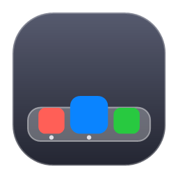
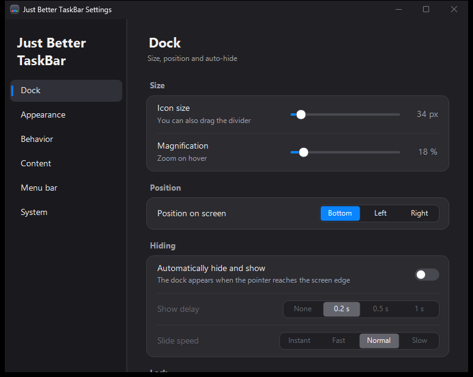

<p align="center">
  
</p>

<h1 align="center">Just Better TaskBar</h1>

<p align="center">A lightweight macOS-style dock and menu bar for Windows.<br>
Single native executable, no runtime, around 12 MB of memory.</p>

---

## Features

**Dock**
- Magnification on hover, launch bounce and attention bounce
- Pinned and running apps in one row, or split with a divider
- Drag to reorder, drag in an `.exe`, `.lnk` or folder to pin it, drag out to remove
- Running indicators: dot, highlight or blue line
- Live previews of minimized windows
- Folder stacks (Downloads by default) and the Recycle Bin
- Bottom, left or right position, auto-hide with adjustable delay and speed
- Frosted glass background with adjustable vibrancy, light and dark themes
- Hide any app from the dock and the menu bar

**Menu bar**
- Active app name with its classic menus (File, Edit, View…)
- System tray icons of background apps (Steam, Discord…)
- Network, volume (scroll to change), battery, quick settings and clock

**Windows integration**
- Hides the Windows taskbar and restores it on exit
- Reserves screen space so maximized windows stay clear of the dock
- Hides itself in full-screen games and videos

## Settings

Right-click the dock and choose **Settings…**, or run `JustBetterTaskBar.exe --settings`.

<p align="center">
  
</p>

All settings are also stored in `dock.ini` next to the executable.

## Building

Requirements:
- Windows 11
- Visual Studio 2022 or newer with the C++ workload
- Windows SDK 10.0.22621 or newer

```bat
cd src
build.bat
```

This produces `src\JustBetterTaskBar.exe`.

## Usage

| Command | Action |
|---|---|
| `JustBetterTaskBar.exe` | Start the dock |
| `JustBetterTaskBar.exe --settings` | Open the settings window |
| `JustBetterTaskBar.exe --quit` | Quit and bring back the Windows taskbar |

If the app is ever closed from Task Manager, start it again and quit it normally to restore the Windows taskbar.
